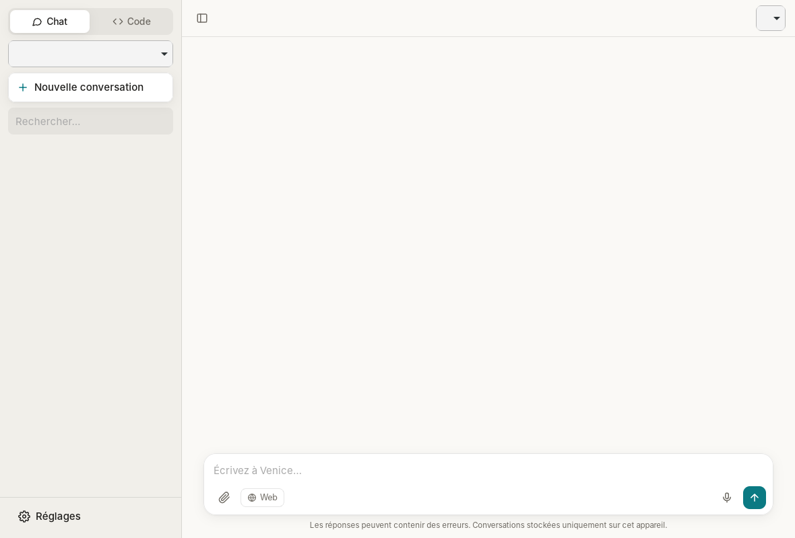
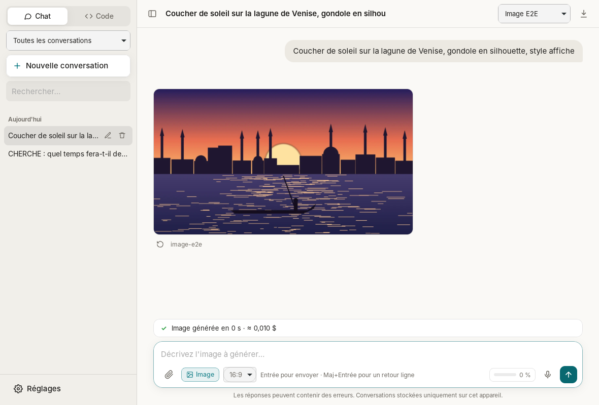
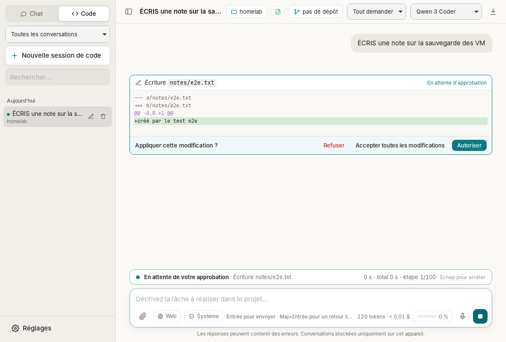

# Venice Desktop

Client de bureau **léger, open source et sans télémétrie** pour l'API [Venice.ai](https://venice.ai), dans l'esprit de Claude Desktop : chat, **agent de code**, **recherche web**, **génération d'images**, **voix**, **PDF** et **serveurs MCP**. macOS, Windows et Linux.

> Projet indépendant, non affilié à Venice.ai. Dérivé de [Mistral Desktop](https://github.com/r0mish/Mistral-Desktop) (même architecture Tauri 2 + Rust).



## Pourquoi Venice

Venice exécute une grande partie de ses modèles open-weight (GLM, Qwen, DeepSeek, Llama, Venice Uncensored…) **sans conserver les requêtes**. Le client affiche pour chaque modèle s'il est :

- **privé** : exécuté par Venice, aucune conservation (option par défaut : seuls ces modèles sont proposés) ;
- **◐ anonymisé** : modèle d'un fournisseur tiers (OpenAI, Anthropic, Google, xAI…), requêtes relayées sans votre identité, mais soumises aux règles de ce fournisseur. Affichables via Réglages → Général → Confidentialité.

## Fonctionnalités

### Chat
- Réponses en **streaming**, arrêt à tout moment (bouton ■ ou `Échap`)
- Rendu **Markdown** : tableaux, listes, blocs de code colorés avec bouton « Copier »
- **Raisonnement** des modèles qui le publient (`reasoning_content` ou balises `<think>`) dans un bloc repliable
- Pièces jointes : **images** (modèles vision), **PDF** et **fichiers texte/code**, par bouton, glisser-déposer ou collage
- Liste des modèles tirée de l'API : nom, contexte, tarif, vision, raisonnement, « non censuré » ; modèle **Automatique** = celui recommandé par Venice
- Historique local : **recherche plein texte**, renommage, suppression, regroupement par date ; modifier un message, régénérer une réponse
- Instructions système, température, tokens max, **export Markdown** (avec les sources)
- **Lecture à voix haute** des réponses (bouton haut-parleur, Kokoro par défaut, voix française `ff_siwis`)

### Génération d'images
Bouton **Image** dans la zone de saisie (onglet Chat) : vos messages deviennent des descriptions d'images.


- Modèles d'image de Venice (liste de l'API), **format** choisi dans la zone de saisie (1:1, 16:9, 9:16…, ou les formats imposés par le modèle)
- Prompt négatif, **mode sûr** (floutage du contenu adulte, activé par défaut), filigrane masqué
- Régénérer, **enregistrer** l'image (boîte « Enregistrer sous » native) ; images stockées dans la conversation, chiffrées comme le reste

### Projets
Comme dans Claude Desktop : des conversations regroupées qui partagent des **consignes** et des **fichiers de référence** (texte, Markdown, code, CSV, PDF).
- Sélecteur en haut de la barre latérale : filtre les conversations ; les nouvelles conversations sont rattachées au projet affiché
- **Dossier de travail** du projet : dossier local ou dossier d'un **serveur SSH**
- **Gros projets** (au-delà de 60 000 caractères) : recherche locale BM25 par extraits ; seuls les passages pertinents sont envoyés, et le modèle dispose d'un outil `search_project_files`. Aucun index ni embedding ne quitte la machine

### Recherche web
Bascule **Web** dans la zone de saisie. Quatre fournisseurs (Réglages → Outils) :
- **Venice** (défaut) : recherche intégrée à l'API (`venice_parameters.enable_web_search`), déclenchée automatiquement par le modèle ou à chaque message ; **sources citées** avec renvois numérotés cliquables
- **Brave via Venice** : outil `web_search` (le modèle formule ses requêtes, peut en lancer plusieurs), **sans conservation des requêtes** (ZDR)
- **Google via Venice** : idem, requêtes anonymisées
- **SearXNG** auto-hébergé

`fetch_url` lit les pages depuis votre machine ; les adresses du réseau local (routeur, NAS, 10.x, 192.168.x…) sont **bloquées** pour éviter qu'une page piégée ne fasse sonder votre LAN au modèle.

### Dictée vocale
Bouton micro (`Ctrl/⌘+Maj+D`, `Échap` pour annuler) : capture native du micro, transcription par Venice (**Parakeet v3** par défaut, 25 langues européennes ; **Whisper large v3** en option, avec langue et vocabulaire personnalisé). Repli automatique sur Whisper si le modèle choisi est refusé.
- Le son reste **en mémoire** (WAV mono 16 kHz, jamais écrit sur le disque), 15 min max
- **Serveur de transcription auto-hébergé** possible (toute API compatible `/v1/audio/transcriptions` : Speaches/faster-whisper, whisper.cpp, vLLM…) ; la clé Venice n'est alors jamais transmise

### PDF
Extraction du texte **locale** (rien n'est envoyé pour la conversion). Venice ne proposant pas d'OCR, un PDF scanné est signalé : passez-le dans un OCR local ([ocrmypdf](https://github.com/ocrmypdf/OCRmyPDF)) ou joignez des captures à un modèle vision.

### Agent de code (onglet **Code**)



Un agent façon Claude Code travaille dans un dossier de votre machine ou d'un serveur SSH, avec un modèle à appels d'outils (par défaut celui que Venice recommande pour le code) :
- Outils : `list_files`, `read_file`, `search_files` (regex, respecte `.gitignore`), `edit_file` (remplacement exact), `write_file`, `run_command`, `git_status`, `git_diff`, `git_log`
- **Diff coloré** avant chaque modification, approbation commande par commande
- Trois niveaux de permission par session : **Tout demander**, **Modifs auto**, **Autonome** (par défaut, modifiable dans Réglages → Code)
- **Accès système** (bouton « Système », désactivé par défaut) : fichiers hors du projet en chemin absolu (`/etc/fail2ban/jail.local`…), chaque écriture soumise à approbation avec son diff (sauf en Autonome)
- Accès **confiné au dossier choisi** (chemins `..`, absolus et liens symboliques vers l'extérieur refusés)
- **Fichiers de consignes** : `AGENTS.md` (standard ouvert), `VENICE.md` ou `CLAUDE.md` à la racine sont lus automatiquement à chaque tâche, en local comme en SSH. S'il n'y en a pas, l'agent peut le générer
- **Shell** : bash sous macOS/Linux ; sous Windows, Git Bash s'il est installé, sinon PowerShell 7, sinon 5.1

### Serveurs SSH distants
Onglet **Code** → **Serveur SSH…** : lecture, recherche, édition, commandes et git s'exécutent à distance.
- **Client OpenSSH du système** : alias, `ProxyJump`, clés et options de `~/.ssh/config` s'appliquent
- Authentification par **clé/agent**, ou **mot de passe + code 2FA** (TOTP, PAM keyboard-interactive) ; mot de passe facultativement dans le **trousseau du système**, jamais sur disque ni en ligne de commande
- **Hôte inconnu** : empreintes SHA256 affichées avant toute confiance ; clé d'hôte modifiée signalée
- Connexions réutilisées (ControlMaster) sous macOS/Linux ; arrêt fiable du groupe de processus distant

### Git
Bouton **⎇** (`Ctrl/⌘+G`), en local comme en SSH : branches, fichiers modifiés et diff, indexer/retirer/annuler, **commit** avec message généré par le modèle, fetch/pull (`--ff-only`)/push, historique.

### Serveurs MCP
Configuration au **format de Claude Desktop** (Réglages → MCP) :

```json
{
  "mcpServers": {
    "fichiers": {
      "command": "npx",
      "args": ["-y", "@modelcontextprotocol/server-filesystem", "/home/moi/Documents"]
    },
    "distant": {
      "url": "https://mcp.example.org/mcp",
      "headers": { "Authorization": "Bearer JETON" }
    }
  }
}
```

- Transports **stdio** et **Streamable HTTP**, protocole **MCP 2026-07-28** avec repli automatique (≤ 2025-11-25)
- Chaque appel demande votre accord, avec « Toujours autoriser cet outil »
- Non pris en charge : OAuth des serveurs distants (utilisez un en-tête `Authorization`), sampling, elicitation

### Suivi de l'agent
- **Barre d'activité** : phase en cours, chronomètre, numéro d'étape ; bilan en fin de tâche avec bouton **Continuer**
- **Résilience** : nouvel essai automatique (5 fois, `Retry-After` respecté) sur 429/5xx et coupures réseau ; flux muet 120 s interrompu
- **Jauge de contexte** et **compaction automatique** à 80 % (résumé par le modèle)
- **Consommation** : tokens et coût estimé par conversation et par jour, d'après les **tarifs publiés par l'API** ; **solde du compte** (USD, DIEM, crédits) dans Réglages → Utilisation
- **Mises à jour** signées (minisign), désactivables

### Raccourcis
`Ctrl/⌘+N` nouvelle conversation · `Ctrl/⌘+1` / `2` Chat / Code · `Ctrl/⌘+K` recherche · `Ctrl/⌘+B` barre latérale · `Ctrl/⌘+,` réglages · `Ctrl/⌘+G` panneau Git · `Ctrl/⌘+Maj+D` dictée · `Échap` arrêter

## Vie privée et sécurité

| Point | Choix |
|---|---|
| Télémétrie | Aucune. Seule requête non sollicitée : vérification de mise à jour (`api.github.com`, sans identifiant), désactivable. |
| Modèles | **Privés uniquement** par défaut (exécutés par Venice sans conservation). Les modèles de fournisseurs tiers sont signalés ◐ et masqués tant que vous ne les activez pas. |
| Invite système Venice | Désactivée par défaut (`include_venice_system_prompt: false`) : seules vos instructions s'appliquent. |
| Clé API | **Trousseau du système** (Keychain, Credential Manager, Secret Service/KWallet). Repli : variable `VENICE_API_KEY`. |
| Appels réseau | Faits **côté Rust** (magasin de certificats du système) ; la clé n'est jamais exposée à la WebView. Destinations : l'URL d'API configurée, l'instance SearXNG éventuelle, les pages lues par `fetch_url`, vos serveurs MCP, votre serveur de transcription. |
| Conversations | Fichiers JSON locaux, jamais synchronisés, **chiffrés par défaut** (XChaCha20-Poly1305, clé de 256 bits dans le trousseau) : conversations (images générées comprises), index, projets et `mcp.json`. Clé de récupération à sauvegarder dans votre gestionnaire de mots de passe (Réglages → Général). |
| WebView | CSP stricte (aucune ressource distante, donc aucun pixel de suivi), HTML assaini par DOMPurify, liens ouverts dans le navigateur du système. |
| Agent de code | Dossiers autorisés uniquement via la boîte de dialogue native ou une connexion SSH validée. ⚠️ En mode **Autonome**, les commandes s'exécutent avec vos droits sans confirmation : à réserver aux projets de confiance. |
| Voix | Micro ouvert uniquement pendant l'enregistrement ; audio en mémoire. Synthèse vocale lue en mémoire, jamais enregistrée. |
| Auto-hébergement | URL d'API configurable : tout serveur compatible OpenAI (vLLM, Ollama, llama.cpp…), par ex. `http://localhost:11434/v1`. HTTP en clair accepté seulement sur `localhost`. Avec SearXNG, l'extraction PDF locale et un serveur de transcription local, fonctionnement **100 % local** possible (images, synthèse vocale et recherche intégrée nécessitent l'API Venice). |

Emplacements locaux :

| OS | Données (conversations, dossiers autorisés) | Réglages (`settings.json`, `mcp.json`) |
|---|---|---|
| Linux | `~/.local/share/dev.r0mish.venice-desktop/` (+ `projects/`) | `~/.config/dev.r0mish.venice-desktop/` |
| macOS | `~/Library/Application Support/dev.r0mish.venice-desktop/` | idem |
| Windows | `%APPDATA%\dev.r0mish.venice-desktop\` | idem |

## Installation

### Binaires

Installateurs dans les [Releases](https://github.com/r0mish/Venice-Desktop/releases) : `.dmg` (macOS Apple Silicon et Intel), `.exe`/`.msi` (Windows), `.deb`, `.rpm` et `.AppImage` (Linux).

Une release est construite et publiée automatiquement pour tous les systèmes dès qu'une version jamais publiée (`version` dans `src-tauri/tauri.conf.json`) arrive sur `main` ; lancement manuel possible : Actions → Release → Run workflow.

Les binaires ne sont pas signés :
- **macOS** : `xattr -cr "/Applications/Venice Desktop.app"` au premier lancement
- **Windows** : SmartScreen → « Informations complémentaires » → « Exécuter quand même »

### Mises à jour signées (mainteneurs)

Une seule fois :

```bash
npx @tauri-apps/cli signer generate -w ~/.tauri/venice-desktop.key
```

Puis dans le dépôt GitHub → Settings → Secrets and variables → Actions :
- secret `TAURI_SIGNING_PRIVATE_KEY` : contenu de `~/.tauri/venice-desktop.key`
- secret `TAURI_SIGNING_PRIVATE_KEY_PASSWORD` : le mot de passe choisi
- variable `TAURI_UPDATER_PUBKEY` : contenu de `~/.tauri/venice-desktop.key.pub`

Sans ces clés, tout fonctionne (téléchargement manuel des mises à jour).

### Compilation

Prérequis : [Rust](https://rustup.rs) stable, Node.js ≥ 20, et sous Linux :

```bash
# Debian / Ubuntu
sudo apt install libwebkit2gtk-4.1-dev libayatana-appindicator3-dev librsvg2-dev libssl-dev libasound2-dev build-essential
# Fedora
sudo dnf install webkit2gtk4.1-devel libappindicator-gtk3-devel librsvg2-devel openssl-devel alsa-lib-devel
```

```bash
npm ci
npm run tauri dev      # développement
npm run tauri build    # installateurs dans src-tauri/target/release/bundle/
```

## Architecture

```
src/                    Interface (TypeScript, sans framework)
  main.ts               Démarrage, raccourcis clavier
  state.ts, ui.ts       État partagé, notifications, thème, modèles (confidentialité, choix automatique)
  sidebar.ts            Barre latérale : conversations, recherche, projets
  chrome.ts, thread.ts  Barre du haut et compositeur (Web, Image, format), fil des messages, sources
  run.ts                Envoi, boucle d'agent (streaming, outils, approbations, contexte), génération d'images
  speech.ts             Lecture à voix haute
  attachments.ts        Pièces jointes (images, PDF, texte)
  settings-ui.ts        Réglages, solde ; updates-ui.ts : mises à jour
  agent.ts              Invites système, conversion API, politique d'approbation, cartes d'outils
  markdown.ts           marked + highlight.js + DOMPurify
  api.ts                Appels IPC typés vers Rust
  projects-ui.ts        Projets (consignes, fichiers de référence)
  dictation.ts          Dictée vocale
  ssh-ui.ts, git-ui.ts  Serveurs SSH, panneau Git
src-tauri/src/
  lib.rs                Commandes Tauri, trousseau, annulation, PDF, images, voix
  venice.rs             Client HTTP : chat en streaming (venice_parameters, citations, <think>), modèles,
                        recherche, transcription, synthèse vocale, images, solde
  tools.rs              Registre des outils et exécution
  workspace.rs          Outils de code confinés au dossier de projet
  web.rs                SearXNG, lecture de pages (protection réseau local)
  mcp.rs                Client MCP stdio / HTTP, double génération de protocole
  storage.rs            Stockage JSON atomique, export Markdown, recherche plein texte
  vault.rs              Chiffrement local (XChaCha20-Poly1305, clé dans le trousseau)
  textsearch.rs         Recherche locale : plein texte, découpage et classement BM25
  knowledge.rs          Fichiers de référence des projets : en entier ou extraits pertinents
  audio.rs              Capture du micro (cpal), rééchantillonnage 16 kHz, WAV en mémoire
  target.rs, ssh.rs     Dossier de projet local ou distant (OpenSSH), fichiers de consignes
  askpass.rs            Mots de passe et codes 2FA SSH (SSH_ASKPASS relayé, trousseau)
  git.rs, shell.rs      Git, choix du shell (bash, Git Bash, PowerShell)
e2e/                    Tests de bout en bout : l'application réelle pilotée par tauri-driver
                        (WebDriver) contre un faux serveur Venice et de vrais sshd
```

### Tests

```bash
cd src-tauri && cargo test                               # tests unitaires Rust
npx tauri build --debug --no-bundle                      # Linux : app de test
xvfb-run -a npm run test:e2e                             # tests de bout en bout (tauri-driver, WebKitWebDriver)
```

Tauri 2 utilise la WebView native de l'OS (WebKit, WebView2) : binaire d'environ 10-15 Mo, contre ~150 Mo pour une app Electron.

## Licence

MIT
